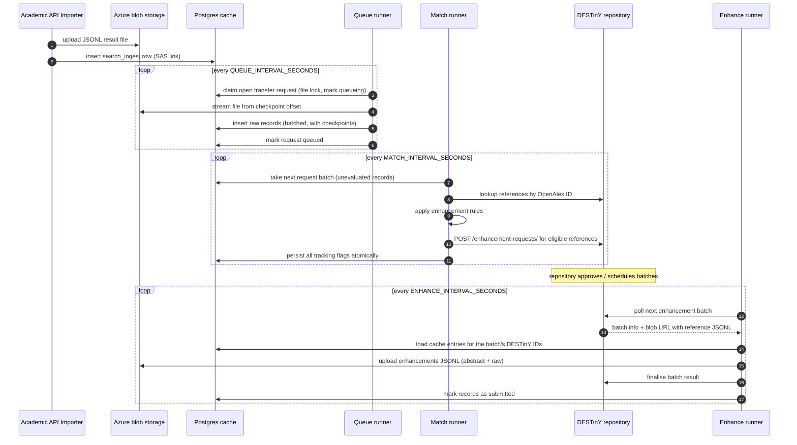

# Architecture

The robot is a set of small, independent **runner** processes that never talk to each other directly. They coordinate exclusively through the Postgres metadata cache and the DESTinY repository itself. Every runner is a `Runner` subclass (`app/util/runner.py`) executing one `_loop_task()` repeatedly, with a configurable pause between iterations for graceful API use.

## Runners

| Runner             | Module                  | Loop interval                             | Job                                                                                                                                                                              |
| ------------------ | ----------------------- | ----------------------------------------- | -------------------------------------------------------------------------------------------------------------------------------------------------------------------------------- |
| **Queue runner**   | `app/robots/queue.py`   | `QUEUE_INTERVAL_SECONDS` (default 1 h)    | Streams JSONL files from Azure blob storage into the `records` table, checkpointing progress on the `search_ingest` row.                                                         |
| **Match runner**   | `app/robots/match.py`   | `MATCH_INTERVAL_SECONDS` (default 30 s)   | Takes a batch of not-yet-evaluated records, looks them up in the repository by OpenAlex ID, filters them through the [enhancement rules](matching.md) and requests enhancements. |
| **Enhance runner** | `app/robots/enhance.py` | `ENHANCE_INTERVAL_SECONDS` (default 30 s) | Polls the repository for approved enhancement batches, fetches the abstracts from the cache and submits the enhancements.                                                        |

!!! info "Queue runner status"
The queue runner is implemented but not yet wired into `run_robot.py` (the CLI currently accepts `match` and `enhance`). It is also not part of `compose.yaml` yet. See [PR #8](https://github.com/destiny-evidence/bulk-abstract-ingest-robot/pull/8).

## End-to-end sequence

## The match → enhance handoff

The match and enhance runners never share in-memory state. The match runner records `abstract_enhancement_required`, `enhancement_requested` and the `destiny_id` on each cache row; the enhance runner later re-reads the records **by DESTinY ID** when the repository hands out an approved batch. This means:

- the repository decides _when_ work is done (the robot only polls),
- the robot can restart at any point without losing track of what was requested vs. submitted,
- the data actually submitted is re-fetched from the cache at submission time, so it always matches the latest parsed state of the record.

## Sharing work between processes

Two mechanisms allow multiple worker processes to run without double work:

**Row-level locks in deterministic order.** When the match runner persists its tracking flags, it first acquires `SELECT … FOR UPDATE` row locks sorted by `record_id`. Workers touching overlapping batches serialise cleanly instead of deadlocking (see `AbstractStore.persist_match_results`).

**File locks per transfer.** Each `search_ingest` transfer is guarded by an OS-level file lock (`AsyncFileLock` under `TRANSFER_LOCKS_PATH`) keyed by the ingest ID, so several queue-runner processes on one host can compete for work without transferring the same file twice. A runner takes the first request it can lock and processes it exclusively.

## Crash resilience

| Failure                                       | Recovery                                                                                                                                                                |
| --------------------------------------------- | ----------------------------------------------------------------------------------------------------------------------------------------------------------------------- |
| Queue runner dies mid-file                    | Progress was checkpointed (`checkpoint_bytes` / `checkpoint_rows`) at every `API_WRAPPER_CHECKPOINT_INTERVAL` rows; the next run resumes streaming at that byte offset. |
| Match runner dies mid-batch                   | All provenance writes happen in **one atomic transaction** — either every tracking flag for the batch is written, or none. Records are re-processed on the next poll.   |
| Enhance runner dies before finalising a batch | The repository never sees a completed batch result and will hand it out again. Double-submitting enhancements is acceptable by design.                                  |
| Whole host dies                               | File locks are released by the OS; checkpoints and tracking flags in Postgres tell the next run exactly where to continue.                                              |

## Related components

- **[Academic API Importer](https://github.com/destiny-evidence/academic-api-importer)** — retrieves the large result sets from vendor APIs (Scopus today) and uploads them to blob storage; its "ingest bridge" is intended to feed the `search_ingest` table so the transfer starts automatically.
- **DESTinY repository** — the target index. Interaction is via `destiny_sdk`: an HMAC-signed `RobotClient` for polling/submitting enhancement batches and a Keycloak-OAuth `OAuthClient` for reference lookups and enhancement requests. See [Authentication](development.md#authentication-against-the-destiny-repository).
- **`scripts/clean_db.sql`** — periodically purges records that are submitted or will never be submitted (raw data stays cheaply available in cold blob storage if ever needed again).
