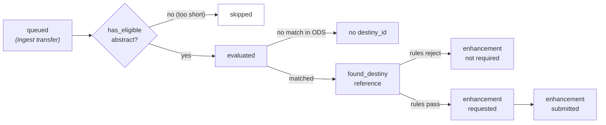
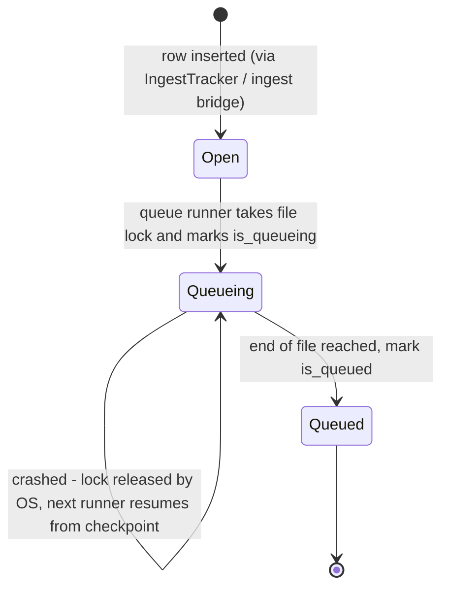

# Data model

The robot owns its Postgres database and treats it as the durable work queue between runners. There are exactly two tables, both created automatically from the SQLModel definitions in `app/db/schemas.py` at startup (`SQLModel.metadata.create_all`).

## `records` — the metadata cache

One row per raw source record (one JSONL line from an export file). The record is stored **unparsed** and only converted into bibliographic fields when a runner needs it — a thin per-format parser (`ParsedRecord._parse_record_kwargs`) maps the raw payload of a given `format` (currently `scopus_api`) onto title, abstract, publication year and identifiers.

??? info "Why raw-first storage?"
Converting on read keeps the ingestion step trivial and lets converter fixes be applied retroactively without re-fetching source data. The raw JSON also travels to the repository as a `RawEnhancement`, so nothing is lost. Formats beyond Scopus are explicitly out of scope for now.

### Identifier columns

| Column                                                                             | Notes                                                                                                      |
| ---------------------------------------------------------------------------------- | ---------------------------------------------------------------------------------------------------------- |
| `record_id`                                                                        | Internal primary key (UUIDv6, time-ordered).                                                               |
| `destiny_id`                                                                       | DESTinY repository ID once the match runner matched the record; indexed.                                   |
| `openalex_id`, `doi`, `wos_id`, `scopus_id`, `s2_id`, `pubmed_id`, `dimensions_id` | External identifiers (indexed). OpenAlex IDs are normalised to `W\d+`, DOIs lowercased without URL prefix. |

### Payload columns

| Column       | Notes                                                                                                                    |
| ------------ | ------------------------------------------------------------------------------------------------------------------------ |
| `format`     | Source shape of the `raw` payload (`scopus_api`, `wos_api`, `pubmed_api`, `dimensions_api`, `openalex_api`, `pik_solr`). |
| `raw`        | The untouched source record as JSONB.                                                                                    |
| `created_at` | When the record was queued; also used as the source export date approximation on raw enhancements.                       |

### Tracking columns

Every flag is written by a specific step of the pipeline, which makes progress observable and lets each runner pick up exactly where it left off:

| Column                          | Set by                       | Meaning                                                                                                                                |
| ------------------------------- | ---------------------------- | -------------------------------------------------------------------------------------------------------------------------------------- |
| `has_eligible_abstract`         | Match runner (batch pick-up) | `false` if the record's own abstract is too short to ever be submitted (`MIN_ABSTRACT_LENGTH`); such records are skipped from then on. |
| `encountered_parsing_error`     | Runners                      | Raw payload could not be parsed.                                                                                                       |
| `evaluated`                     | Match runner                 | The record has been checked against the repository once.                                                                               |
| `found_destiny_reference`       | Match runner                 | A matching reference was found in the repository (`destiny_id` filled).                                                                |
| `abstract_enhancement_required` | Match runner                 | The [enhancement rules](matching.md) say we should submit this abstract.                                                               |
| `enhancement_requested`         | Match runner                 | An enhancement request was successfully sent to the repository.                                                                        |
| `enhancement_submitted`         | Enhance runner               | The enhancement was actually submitted for this record.                                                                                |

A record therefore walks a funnel like this (each stage is one indexed column, so every batch query is a simple "where not yet done" filter):



All flags from the match stage are persisted in a **single transaction** per batch, so an interrupted run never leaves a half-updated batch behind.

## `search_ingest` — transfer requests

One row per source file to ingest. This is both the signal to the queue runner ("there is work") and the progress tracker ("resume here if we crash").

| Column             | Notes                                                                              |
| ------------------ | ---------------------------------------------------------------------------------- |
| `ingest_id`        | Primary key (UUIDv6, also used as the file-lock name).                             |
| `azure_link`       | SAS URL of the JSONL file in blob storage. Contains credentials — treat as secret. |
| `is_queueing`      | A transfer run has claimed this request.                                           |
| `is_queued`        | The transfer completed; all rows are in `records`.                                 |
| `checkpoint_bytes` | Byte offset of the last commit — the resume point after a crash.                   |
| `checkpoint_rows`  | Total number of lines transferred so far.                                          |

### Transfer lifecycle



The queue runner always looks at **open** requests first (`is_queueing = false AND is_queued = false`), then at partially transferred ones, and only processes a request it can lock exclusively. This makes multiple queue-runner processes safe to run side by side, and makes restarting an interrupted file the normal case rather than an error.

## Housekeeping

`scripts/clean_db.sql` purges rows that no longer matter:

```sql
-- Delete records that are older and already submitted or will never be submitted
DELETE
FROM records
WHERE (enhancement_submitted = TRUE OR abstract_enhancement_required = FALSE)
  AND created_at < NOW() - INTERVAL '14 days';
```

!!! warning
Note that `abstract_enhancement_required` defaults to `false`, so this also removes records that were never evaluated if they are older than the cutoff. Run it on a schedule (or manually) only when you are sure those records should not be retried.

Keeping the cache small is cheap: the raw data remains available in (cold) blob storage and can be re-ingested by adding a new `search_ingest` row.
