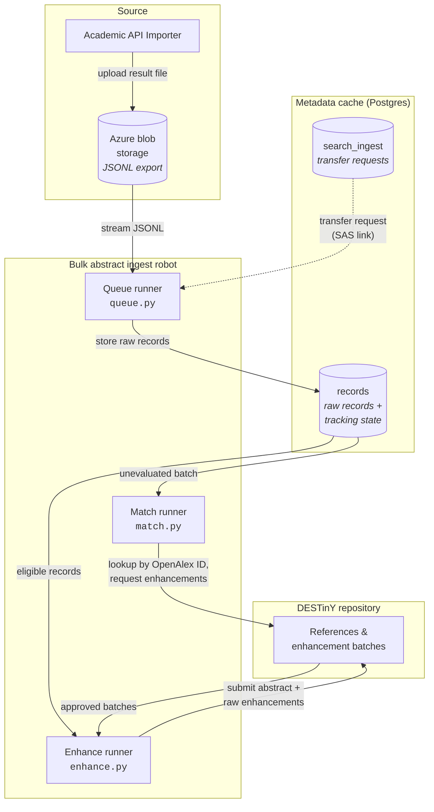

# Bulk abstract ingest robot

This robot improves abstract coverage in the [DESTinY Open Search index](https://github.com/destiny-evidence/destiny-repository) by taking large result sets exported from academic databases (currently Scopus via the [Academic API Importer](https://github.com/destiny-evidence/academic-api-importer)) and offering their abstracts as enhancements to references that are missing one — or whose current abstract looks broken.

## What it does

- **Ingests** JSONL exports from Azure blob storage into a local Postgres metadata cache, with checkpoints so a crashed transfer can resume where it left off.
- **Matches** cached records against the DESTinY repository by OpenAlex ID and checks that the match is plausible (publication year, title similarity).
- **Submits** an `AbstractContentEnhancement` plus a `RawEnhancement` (the untouched source metadata) for every reference that passes the [enhancement rules](matching.md).

## What it deliberately does _not_ do

This is a **temporary measure** to improve coverage until the proper, full-fledged ingestion flow with deduplication and (partial) data fusion is in place. Accordingly, there are intentional decisions:

- _no_ full deduplication — records are matched by identifier (DOI) only,
- _no_ creating new references (canonicals) in the index — existing references are only enhanced,
- _no_ heavy transformation — raw source data is stored as-is and parsed lazily, with a thin per-format parser,
- _no_ data fusion — new metadata is not merged and existing values are not replaces by picking the "better" one.

!!! warning "Temporary project"
This robot is meant to be deprecated once a complete ingestion pipeline with proper deduplication exists.
Changes should be weighed against that end goal (see the discussion in [issue #7](https://github.com/destiny-evidence/bulk-abstract-ingest-robot/issues/7)).

## The flow at a glance

Three small runner processes work through the pipeline, communicating only via the Postgres database and the repository:



Each runner runs its own endless loop and can be restarted at any time — all progress is tracked in the database. The individual steps are explained in [Architecture](architecture.md).

## Where to go next

- [**Architecture**](architecture.md) — the three runners, how they hand work to each other, and how the design survives crashes.
- [**Data model**](data-model.md) — the two tables (`search_ingest`, `records`) and their tracking columns.
- [**Enhancement rules**](matching.md) — when an abstract is considered worth submitting, including the decision tree.
- [**Configuration**](configuration.md) — all environment variables and logging options.
- [**Development & operations**](development.md) — setting up a dev environment, running the robot, Docker Compose, deployment notes.

## Project structure

```plain
run_robot.py            # Typer CLI entry point (tasks: match, enhance)
app/
├── robots/             # The runners — one loop task per module
│   ├── queue.py        #   blob storage → records table ("transfer")
│   ├── match.py        #   records → repository lookups + enhancement requests
│   └── enhance.py      #   approved batches → enhancement submissions
├── util/               # Shared runner boilerplate
│   ├── runner.py       #   Abstract Runner base class (main loop, shutdown)
│   ├── repository.py   #   DESTinY repository client wrapper
│   ├── config.py       #   pydantic-settings (env vars / .env)
│   └── logging.py      #   logging config loader
└── db/                 # Models and database wrapper
    ├── schemas.py      #   SQLModel models (Record, SearchIngest, …)
    ├── engine.py       #   async engine/session helpers
    ├── store.py        #   AbstractStore — queries for match/enhance runners
    └── ingest.py       #   IngestTracker — transfer requests, checkpoints, locks
```

Both tables are created automatically by SQLModel on startup, so a plain Postgres instance (or the `postgres` service in `compose.yaml`) is all that's needed.
