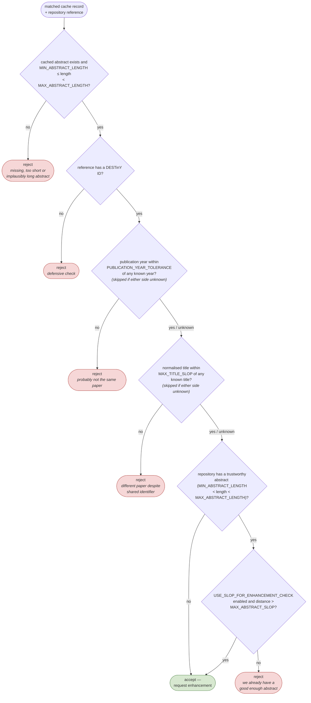

# Enhancement rules

The heart of the robot is a deliberately simple question, asked once per cached record by the match runner (`MatchRunner.should_enhance`, `app/robots/match.py`):

> _Is this cached abstract sufficiently different (or the repository abstract sufficiently absent/broken) that submitting it improves the index without a meaningful risk of overwriting something correct?_

This is **not** deduplication — it is a plausibility filter. Full deduplication and data fusion will live in the proper ingestion flow that eventually replaces this robot.

## How records reach the check

1. The match runner selects the next `REQUEST_BATCH_SIZE` records whose `evaluated` flag is not yet `true` and which were not already ruled out via `has_eligible_abstract = false`.
2. Records whose own abstract is shorter than `MIN_ABSTRACT_LENGTH` are flagged `has_eligible_abstract = false` and dropped — they can never produce a useful enhancement. (The upper length bound is _not_ part of this cheap pre-filter; over-long abstracts are rejected later by the decision tree below.)
3. The remaining records are looked up in the repository **by OpenAlex ID** (`app/util/repository.py`). Every reference the lookup returns is checked independently — if a DOI/OpenAlex ID maps to more than one canonical reference, each one passes or fails on its own merits.

## The decision tree

### About the comparisons

- Titles and abstracts are **normalised before comparison**: lowercased, all non-`a-z` characters removed. This catches formatting/encoding noise cheaply while keeping the logic honest about being a heuristic.
- Year and title checks are skipped whenever either side has no information — absence of data is never treated as a mismatch.
- Abstract **length is used as a trustworthiness signal on both sides**: only abstracts between `MIN_ABSTRACT_LENGTH` and `MAX_ABSTRACT_LENGTH` count. An over-long repository abstract is treated as broken garbage and does not block an enhancement — and an over-long cached abstract is never submitted.
- **How a trustworthy repository abstract is judged depends on `USE_SLOP_FOR_ENHANCEMENT_CHECK`:**
  - _Off (default):_ mere presence of a trustworthy abstract is enough — "someone already wrote something of plausible quality here, leave it alone". No similarity is computed.
  - _On:_ the abstracts are compared, and only a _sufficiently similar_ repository abstract (distance ≤ `MAX_ABSTRACT_SLOP`) suppresses the enhancement.
- The similarity measure (used for titles, and for abstracts in slop mode) is a `difflib.ndiff`-based per-character distance over the normalised strings, not a semantic check. Tuning the slop thresholds quickly becomes a slippery slope, so the thresholds are intentionally blunt (see `MAX_TITLE_SLOP` / `MAX_ABSTRACT_SLOP` in [Configuration](configuration.md)).

## What gets submitted

For every accepted record the enhance runner submits **two enhancements** (see `Repository._records_to_enhancements`):

| Enhancement                  | Content                                                                                                                                                                  |
| ---------------------------- | ------------------------------------------------------------------------------------------------------------------------------------------------------------------------ |
| `AbstractContentEnhancement` | The cached abstract (`process = OTHER`).                                                                                                                                 |
| `RawEnhancement`             | The entire raw source record plus known external identifiers and the source export date — nothing is thrown away, so future pipelines can use fields this robot ignores. |

Both are submitted with `RESTRICTED` visibility and a provenance string built from `REPOSITORY_PROVENANCE` and the source database, e.g. `PIK Metadata Cache (SCOPUS)`.

<!-- prettier-ignore -->
!!! note "Why submit the raw payload even when the abstract is rejected?"
  It isn't — currently raw enhancements accompany accepted abstracts only. The open question of attaching `RawEnhancement`s to _all_ plausible matches (not just those with a new abstract) was raised in [issue #7](https://github.com/destiny-evidence/bulk-abstract-ingest-robot/issues/7) and is not implemented.

## Design rationale

The rules were refined while planning the API-wrapper ingestion ([issue #7](https://github.com/destiny-evidence/bulk-abstract-ingest-robot/issues/7), [PR #8](https://github.com/destiny-evidence/bulk-abstract-ingest-robot/pull/8)). Key decisions and accepted trade-offs:

- **Match by identifier only.** DOIs (and OpenAlex IDs) are not perfectly reliable, and production data shows roughly 1 in 500 DOIs held by two unmerged references. The year + title plausibility checks exist precisely so that a wrong identifier match fails the rules instead of getting a wrong abstract.
- **Title similarity was added** compared to the first version of the robot (which only checked year tolerance and abstract mismatch) to reduce false-positive matches.
- **"Different enough" replaces "always submit".** Rather than offering any abstract we have, we only submit when the repository lacks a trustworthy abstract for the reference — and, in the opt-in similarity mode, lacks a _similar_ one. We deliberately do _not_ try to judge which abstract "looks better" (e.g. always preferring the longer one) — that decision belongs to a future best-abstract mechanism.
- **Presence-only checking is the default.** Comparing abstract text cheaply conflates "different wording of the same abstract" with "a genuinely better abstract", and any submission risks burying a good existing one. So the default mode submits only where no plausible abstract exists at all; `USE_SLOP_FOR_ENHANCEMENT_CHECK` restores the old distance-based comparison for deployments that want to push replacements.
- **Length bounds abstract trustworthiness in both directions.** Very short payloads carry no information, and absurdly long ones are usually parsing garbage (affiliation dumps, whole first pages) — so abstracts outside `MIN_ABSTRACT_LENGTH` … `MAX_ABSTRACT_LENGTH` neither block enhancements nor get submitted.
- **Double submissions are acceptable.** The repository handles duplicate enhancements; the robot does not spend effort preventing them.
- **No new references.** The robot only enhances what already exists in the index.
